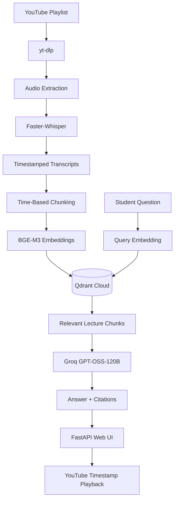

# 🎓 YT Lecture RAG
### Retrieval-Augmented Generation over YouTube DSA Lectures

[](https://www.python.org/)
[](https://fastapi.tiangolo.com/)
[](https://qdrant.tech/)
[](https://groq.com/)
[](https://github.com/SYSTRAN/faster-whisper)
[](LICENSE)

**Ask questions about DSA lectures in English or Hinglish and get accurate answers with clickable YouTube timestamps.**

Instead of returning generic AI-generated explanations, YT Lecture RAG retrieves the exact lecture segments where a concept was explained.

### 💡 Example

**Student asks:**

> "Where the difference between memoization and tabulation was explained??"

**AI Answer:**

A concise 3–4 line answer grounded only in the retrieved lecture content.

**📚 Sources:**

| Lecture | Timestamp |
|---|---|
| DP Lecture 3 – Memoization Deep Dive | [▶ 12:04](#) |
| DP Lecture 5 – Tabulation Recipe | [▶ 04:31](#) |

*In the application, clicking a citation seeks directly to that timestamp in the embedded YouTube player.*

---

## 📌 Table of Contents

- [Overview](#-overview)
- [Key Features](#-key-features)
- [Architecture](#-architecture)
- [Tech Stack](#-tech-stack)
- [Project Structure](#-project-structure)
- [Installation](#-installation)
- [Configuration](#-configuration)
- [Usage](#-usage)
- [Performance](#-performance)
- [Reliability](#-reliability)
- [Future Improvements](#-future-improvements)

---

## 🚀 Overview

YT Lecture RAG is a Retrieval-Augmented Generation application designed to make long YouTube DSA playlists searchable and interactive.

It processes lecture videos, extracts audio, generates timestamped transcripts, divides them into meaningful chunks, creates embeddings, and stores them in Qdrant.

When a student asks a question, the system retrieves relevant lecture segments and uses an LLM to generate an answer with source citations.

**The main goal:** Help students find exactly where a topic was taught without watching entire lectures again.

## ✨ Key Features

- 🎥 **YouTube Playlist Ingestion** – Extracts audio from entire YouTube playlists.
- 🎙️ **Speech-to-Text** – Uses Faster-Whisper (large-v3) for transcription.
- ✂️ **Time-Based Chunking** – Preserves timestamps for accurate source retrieval.
- 🧠 **Semantic Search** – Uses BGE-M3 embeddings for multilingual retrieval.
- 🗄️ **Vector Database** – Stores and retrieves lecture chunks using Qdrant Cloud.
- 🤖 **AI-Powered Answers** – Uses Groq's GPT-OSS-120B model.
- 🌐 **Hinglish Support** – Accepts English and romanised Hinglish questions.
- 🔗 **Timestamp Citations** – Jump directly to the relevant moment in a lecture.
- 💻 **Web Interface** – FastAPI backend with an embedded YouTube player.
- ♻️ **Incremental Processing** – Reuses cached transcripts to avoid unnecessary transcription.

## 🏗️ Architecture



## 🛠️ Tech Stack

| Layer | Technology |
|---|---|
| Language | Python 3.11 |
| YouTube Extraction | yt-dlp |
| Transcription | Faster-Whisper (large-v3) |
| Audio Processing | PyAV |
| Chunking | Custom Time-Based Chunking |
| Embeddings | Sentence Transformers – BAAI/bge-m3 |
| Vector Database | Qdrant Cloud |
| LLM | Groq – GPT-OSS-120B |
| CLI | Typer + Rich |
| Backend | FastAPI |
| Frontend | HTML + YouTube IFrame API |
| Environment | uv |

## 📂 Project Structure

```text
YT_SCRAPPER/
│
├── ytrag/
│   └── ytrag/
│       ├── __init__.py
│       ├── answer.py
│       ├── chunk.py
│       ├── cli.py
│       ├── config.py
│       ├── embed.py
│       ├── evaluate.py
│       ├── index.py
│       ├── models.py
│       ├── playlist.py
│       ├── transcribe.py
│       └── util.py
│
├── eval/
├── index/
├── transcripts/
├── main.py
├── pyproject.toml
├── uv.lock
├── RAGPLAN.md
├── SETUP.md
└── README.md
```

## ⚙️ Installation

### Prerequisites

- Python 3.11
- Git
- uv package manager
- Groq API key
- Qdrant Cloud account
- NVIDIA GPU (recommended for faster transcription)

### 1. Clone the repository

```bash
git clone https://github.com/AmbatiNavaneeth/YT_SCRAPPER.git
cd YT_SCRAPPER
```

### 2. Create virtual environment

```bash
uv venv --python 3.11
```

### 3. Install dependencies

```bash
uv sync
```

### 4. Optional: Enable CUDA acceleration

```bash
uv sync --extra cuda
```

## 🔐 Configuration

Create a `.env` file in the repository root:

```env
GROQ_API_KEY=your_groq_api_key
QDRANT_URL=your_qdrant_url
QDRANT_API_KEY=your_qdrant_api_key
```

Never commit your actual `.env` file or API keys to GitHub.

## ▶️ Usage

### 1. Preflight Checks

Verify dependencies, API connections, Qdrant, Whisper and playlist access before starting ingestion.

```bash
uv run ytrag preflight --playlist "<PLAYLIST_URL>"
```

### 2. Test Transcription Language

```bash
uv run ytrag langtest "https://www.youtube.com/watch?v=<VIDEO_ID>"
```

Compare Hindi and English transcription output and choose the language setting that preserves technical terminology.

### 3. Ingest YouTube Playlist

Start with one video:

```bash
uv run ytrag ingest --playlist "<PLAYLIST_URL>" --limit 1
```

Process the entire playlist:

```bash
uv run ytrag ingest --playlist "<PLAYLIST_URL>"
```

**Processing pipeline:**

1. Download audio using yt-dlp.
2. Transcribe using Faster-Whisper.
3. Cache transcripts.
4. Delete temporary audio.
5. Generate timestamp-based chunks.
6. Create BGE-M3 embeddings.
7. Store vectors in Qdrant Cloud.

### 4. Ask Questions

```bash
uv run ytrag ask "memoization aur tabulation ka difference kya hai?"
```

### 5. Search Lecture Content

```bash
uv run ytrag search "adjacency list"
```

Retrieves relevant lecture chunks and displays their similarity distances.

### 6. Evaluate Retrieval

```bash
uv run ytrag eval --verbose
```

### 7. Launch Web Application

```bash
uv run ytrag serve
```

Open:

**http://127.0.0.1:8000**

Ask questions through the web interface and click citations to jump to the exact timestamp inside the embedded YouTube player.

## ⚡ Performance Benchmarks

Measured on an RTX 5050 laptop using a 68.7-hour playlist.

| Configuration | Speed | Estimated Time |
|---|---:|---:|
| Sequential, Beam 5 | 2.5x | ~27 hours |
| Batch 8, Beam 5 | 8.1x | ~8.5 hours |
| Batch 8, Beam 1 | 10.5x | ~6.5 hours |

**Default configuration:** Batch 8 with Beam 5, balancing transcription speed and technical-term accuracy.

## 🔄 Reliability & Caching

The ingestion pipeline is designed to handle long-running processing jobs.

- **Power interruption:** Completed transcripts are preserved using atomic file writes.
- **Network failures:** Downloads and Qdrant upserts use retries with exponential backoff.
- **Duplicate prevention:** Re-running ingestion skips already processed videos.
- **Graceful interruption:** Ctrl+C preserves completed work.
- **Failure handling:** Consecutive failures trigger an automatic stop.
- **Model caching:** Whisper and embedding models are cached locally.

### Runtime Data

```text
~/.ytrag/
│
├── audio/
├── transcripts/
└── langtest/
```

Transcripts are preserved because they are expensive to regenerate. Audio files are temporary and can be recreated when needed.

## 🧰 Additional Commands

| Command | Purpose |
|---|---|
| `uv run ytrag preflight` | Validate dependencies |
| `uv run ytrag reindex` | Re-chunk and re-embed cached transcripts |
| `uv run ytrag reindex --replace` | Replace existing indexed chunks |
| `uv run ytrag stats` | Display indexing statistics |
| `uv run ytrag clean-audio` | Remove cached audio |

## 🔮 Future Improvements

- Hybrid search combining dense and sparse retrieval.
- Cross-encoder reranking for better retrieval accuracy.
- Conversation memory for follow-up questions.
- Improved Hinglish query understanding.
- Deployment with a publicly accessible web interface.
- Expanded evaluation using retrieval precision and answer faithfulness.

## 👨‍💻 Author

**Navaneeth Ambati**

B.Tech – Information Technology | 2026 Graduate

- GitHub: [@AmbatiNavaneeth](https://github.com/AmbatiNavaneeth)
- LinkedIn: [Connect with me](https://www.linkedin.com/in/ambatinavaneeth/)

---

⭐ If you find this project interesting, consider giving the repository a star!

**Built to make learning from long technical lectures faster, searchable, and more accessible.**
